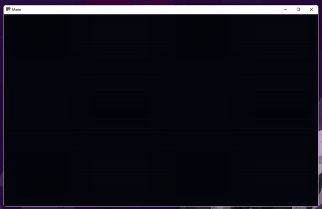

# Marin — Local Voice Assistant for Windows

Marin is a "Jarvis-style" personal voice assistant that runs on your own PC. Say **"Marin"**, ask for something in Brazilian Portuguese, and she listens, understands, acts on your computer and answers out loud.

The brain is a **local LLM (Ollama)**, so conversations stay private and cost nothing to run.

> 🇧🇷 Versão em português: [README.pt-BR.md](README.pt-BR.md)

> 🚧 **Work in progress.** Marin already works day to day, and I keep adding features (see the [Roadmap](#roadmap)).

<!-- Add a short demo GIF or video here:  -->

## Features

| Area | Examples (spoken in Portuguese) |
|---|---|
| PC control | open/close apps, open websites, set volume, take a screenshot, lock or shut down the PC (asks for confirmation) |
| Time, weather and search | date and time, weather forecast for any city (Open-Meteo), web search (DuckDuckGo) |
| Music and YouTube | play a song or artist on YouTube, pause, next track |
| Reminders and notes | "remind me to drink water in 30 minutes", scheduled reminders, take and read notes |
| Conversation | keeps short-term context, so you can keep talking for a few seconds without saying her name |

Other details:

- **Wake word** ("Marin") with tolerant matching for how Whisper transcribes the name
- **Global hotkey** (`Ctrl+Alt+M`) and a text box as alternatives to voice
- **HUD interface** built with `pywebview`, plus a terminal-only mode
- **Two voice engines:** ElevenLabs (natural, custom voice) with automatic fallback to the free Edge TTS, and to the offline Windows voice without internet
- **Tool calling:** the LLM picks which skill to run; adding a new skill is a single decorated function

## How it works

```
Microphone → speech detection → Whisper (speech-to-text)
          → Ollama LLM + tool calling → skill runs on the PC
          → ElevenLabs / Edge TTS (text-to-speech) → speakers
```

## Tech stack

- **Python 3.12**
- **Speech-to-text:** [faster-whisper](https://github.com/SYSTRAN/faster-whisper) (GPU with CUDA, or CPU)
- **LLM:** [Ollama](https://ollama.com) running `qwen2.5:7b` locally (fits in 8 GB of VRAM)
- **Text-to-speech:** ElevenLabs API, `edge-tts`, `pyttsx3`
- **Audio:** `sounddevice`, `numpy`, `pygame`
- **UI:** `pywebview` (HTML/CSS/JS HUD)
- **Other:** `requests`, `ddgs`, `keyboard`, `Pillow`

## Project structure

```
main.py              orchestrates everything (listen → understand → act → speak)
config.py            settings (name, city, voice, model, mic sensitivity, hotkey)
core/audio.py        microphone and speech detection
core/stt.py          speech-to-text (faster-whisper)
core/cerebro.py      local LLM (Ollama) + tool calling
core/ferramentas.py  skills (PC control, weather, search, music...)
core/tts.py          text-to-speech (ElevenLabs, Edge, Windows)
core/lembretes.py    reminders
hud/index.html       interface
```

## Getting started

**Requirements:** Windows 10/11, Python 3.12, a microphone. An NVIDIA GPU is recommended but not required.

1. Clone the repository:
   ```bash
   git clone https://github.com/levyespigue14-ux/marin.git
   cd marin
   ```
2. Run **`instalar.bat`**. It creates the virtual environment, installs the dependencies, installs Ollama and downloads the models (about 6 GB).
3. *(Optional)* For the natural voice, copy `.env.example` to `.env` and add your ElevenLabs API key. Without it, Marin uses the free Edge voice.
4. Run **`iniciar.bat`** and say *"Marin, que horas são?"*

Useful flags: `python main.py --terminal` (voice only, no window) and `python main.py --microfones` (list microphones).

## Adding a new skill

Skills live in `core/ferramentas.py`. Decorate a function and the LLM can use it right away:

```python
@habilidade("Opens the projects folder.")
def abrir_projetos():
    os.startfile(r"C:\path\to\projects")
    return "Projects folder opened."
```

## Roadmap

- [ ] Demo video in this README
- [ ] More skills (calendar, e-mail, file search)
- [ ] English language support
- [ ] Automated tests for the skills
- [ ] Linux support

## Author

**João Levy** — Back-end developer (Python and Java), Systems Analysis and Development student.

- GitHub: [@levyespigue14-ux](https://github.com/levyespigue14-ux)
- LinkedIn: [joao-levy](https://www.linkedin.com/in/joao-levy-4008521b2)
